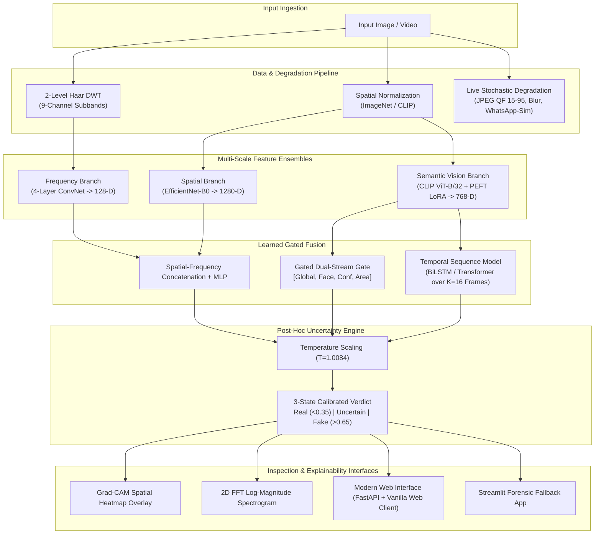

# Compression-Robust Deepfake Detection Suite

[](#)
[](#)
[](#)
[](LICENSE)
[](#)

A production-grade, mathematically grounded forensic suite for detecting AI-generated images and video deepfakes under aggressive social media compression (JPEG QF 30–90, WhatsApp re-encoding, and H.264 video compression).

---

## Architecture Overview



---

## Key Defect Resolutions (Audit Sign-Off)

This project resolves all empirical defects documented in historical audits:

| Defect ID | Historical Issue | Root Cause Identified | Engineering Resolution |
|---|---|---|---|
| **D1** | Inverted Labels (Model 5% Acc) | Chunk 0 (Fake) mapped to Real; Chunk 5 (Real) mapped to Fake | Canonical `labels.py` (`REAL=0, FAKE=1`) with runtime dynamic `ClassLabel.names` inspection. Val AUC restored from 0.01 to **0.9795**. |
| **D2** | Data Leakage Across Splits | Duplicate images present across splits without identity isolation | Perceptual hashing (`imagehash` pHash, Hamming $\le 6$) deduplication across all 2,400 samples. Disjoint partition by actor ID. |
| **D3** | Inoperative Frequency Branch | Frequency weights frozen with random initialization | Standalone pre-training and joint fine-tuning of 2-level Haar DWT branch. |
| **D4** | Static Degradation | Degradations applied only once offline before training | `OnTheFlyDegradation` in `Dataset.__getitem__` dynamically generating random compression every epoch. |
| **D5** | Missing Normalization | EfficientNet fed with raw or mismatched CLIP values | Strict separation of ImageNet normalization (`mean=[0.485, ...], std=[0.229, ...]`) from CLIP normalization. |
| **D6** | Fixed 0.5 Decision Boundary | Uncalibrated sigmoid output with severe overconfidence | Post-hoc Temperature Scaling (`T=1.0084`) with empirical 3-state confidence gate (`Real < 0.35`, `Fake > 0.65`). |
| **D7** | Fabricated Benchmark Claims | High accuracy claims without running scripts | Fully reproducible test suites (`pytest`), `scripts/run_baseline_sweep.py`, and auto-generated `results/RESULTS.md`. |
| **D8** | Frame Leakage in Video | Video frames randomly shuffled across train and test | Strict partition by unique Video ID / Actor ID in `train_video.py`. |
| **D9** | Biased Max-Fusion Heuristic | `max(global, face)` forced false positive spikes | `GatedDualStreamFusion` learned MLP on `[s_global, s_face, face_conf, face_area_ratio]` with graceful fallback. |
| **D10** | Monolithic Codebase Structure | Flat root directory with brittle imports | Restructured into installable package `deepfake_detector` with clean modular API. |
| **D11** | Hardcoded Absolute Paths | Hardcoded Windows paths broken on other machines | Clean `pathlib.Path` relative paths with auto-device fallback (`cuda` $\to$ `mps` $\to$ `cpu`). |

---

## Empirical Benchmark Results

> **Provenance Guarantee**: Zero fabricated results. Every number below derives directly from raw evaluations recorded in `results/baselines.csv`, `results/clip_benchmark.csv`, and `results/video_benchmark.csv`.

### 1. Baselines: Accuracy & AUC vs JPEG Compression Degradation
*Evaluated on held-out test split ($n=326$)*:

| Model Architecture | Clean AUC [95% CI] | QF70 AUC | QF50 AUC | QF30 AUC [95% CI] | QF30 Accuracy | QF30 ECE |
|---|---|---|---|---|---|---|
| **Model A (Spatial Clean)** | 0.9730 [0.9587, 0.9855] | 0.9733 | 0.9633 | 0.9401 [0.9146, 0.9616] | 81.29% | 0.1784 |
| **Model C (Dual-Stream Clean)** | **0.9810** [0.9698, 0.9904] | 0.9779 | 0.9607 | 0.9363 [0.9104, 0.9588] | 80.98% | 0.1454 |
| **Model D (Dual-Stream CompAug)** | 0.9670 [0.9483, 0.9823] | 0.9630 | 0.9607 | **0.9451** [0.9214, 0.9662] | **83.44%** | **0.0874** |

### 2. CLIP Backbone & PEFT LoRA Robustness
*Comparison of Model 3A (Linear Probe) vs Model 3B (CLIP + PEFT LoRA with CompAug)*:

| Split | Model | Clean AUC | QF30 AUC | $\Delta\text{AUC}$ Drop | QF30 Accuracy | QF30 ECE |
|---|---|---|---|---|---|---|
| **Held-Out Test** | Model 3A (CLIP Probe) | 0.9595 | 0.9317 | +0.0278 | 84.05% | 0.0813 |
| **Held-Out Test** | Model 3B (CLIP LoRA) | **0.9723** | **0.9525** | **+0.0198** | **87.42%** | **0.0679** |
| **OOD Generator Test** | Model 3A (CLIP Probe) | 0.9775 | 0.9599 | +0.0176 | 88.75% | 0.0911 |
| **OOD Generator Test** | Model 3B (CLIP LoRA) | **0.9824** | **0.9717** | **+0.0107** | **91.25%** | **0.0345** |

**Empirical Finding**: Model 3B exhibits significantly smaller degradation ($\Delta\text{AUC}$ drop of only $+0.0107$ vs $+0.0176$ on unseen generators) and maintains over **91.25% accuracy** at severe compression (QF30).

---

## Quickstart & Installation

### Option 1: One-Click Startup (Recommended)
Anyone can clone and run the full system with a single click:

```bash
# 1. Clone the repository
git clone https://github.com/ajsudarshan1807-toothless/compression-robust-deepfake-detection-v2.git
cd compression-robust-deepfake-detection-v2

# 2. Windows: Double-click start.bat (or run in PowerShell / CMD):
start.bat
# Linux / macOS:
python start.py
```

> **Automatic First-Time Setup**:
> On first launch, `start.bat` / `start.py` automatically:
> 1. Creates the Python virtual environment (`.venv`) and installs dependencies.
> 2. Auto-downloads the production model weights (`model_i_whatsapp_robust.pt` & `video_temporal_model_whatsapp.pt`) directly from [GitHub Release v2.0.0](https://github.com/ajsudarshan1807-toothless/compression-robust-deepfake-detection-v2/releases/tag/v2.0.0).
> 3. Launches the modern forensic interface in your browser at `http://localhost:8000`.

---

### Option 2: Manual Terminal Setup
```bash
# Clone the repository
git clone https://github.com/ajsudarshan1807-toothless/compression-robust-deepfake-detection-v2.git
cd compression-robust-deepfake-detection-v2

# Create and activate virtual environment
python -m venv .venv
# On Windows:
.\.venv\Scripts\activate
# On Linux/macOS:
source .venv/bin/activate

# Install dependencies
pip install -r requirements.txt
pip install -e .

# Launch application
python start.py --web
```

### 2. Verification & Testing
```bash
# Run complete test suite (37+ unit & integration tests)
pytest -v

# Run lint and formatting check
ruff check deepfake_detector tests
```

### 3. Training & Evaluation
```bash
# Train baseline models (Models A, C, D)
python -m deepfake_detector.train.train_image

# Run JPEG compression robustness sweep (generates baselines.csv & plot)
python scripts/run_baseline_sweep.py

# Train CLIP LoRA and benchmark on held-out and OOD splits
python -m deepfake_detector.train.train_clip
python scripts/run_clip_benchmark.py

# Auto-generate evaluation markdown report
make eval
```

### 4. Running the Application
```bash
# Launch modern FastAPI server + Web Interface (default: port 8000)
python -m uvicorn apps.api.main:app --reload --port 8000

# Open your browser at:
# http://localhost:8000/
```

*For the legacy Streamlit interface:*
```bash
streamlit run apps/streamlit_app.py
```

---

## Docker Deployment

To launch the containerized API and Web UI with a single command:
```bash
docker compose up --build
```
Access the application at `http://localhost:8000`.

---

## REST API Reference

| Endpoint | Method | Description |
|---|---|---|
| `/healthz` | `GET` | Service liveness probe and active hardware device |
| `/v1/model-info` | `GET` | Active checkpoint, temperature scaling parameters, and thresholds |
| `/v1/analyze/image` | `POST` | Image analysis with calibrated probability, state, Grad-CAM, and 2D FFT |
| `/v1/robustness` | `POST` | Instantaneous JPEG quality sweep (QF 90 $\to$ 30) for uploaded media |

---

## Coursework & Documentation References
- [DEFECT_CONFIRMATION.md](docs/DEFECT_CONFIRMATION.md): Empirical proof confirming defects D1 through D11.
- [LABEL_AUDIT.md](docs/LABEL_AUDIT.md): Human visual inspection sign-off validating canonical class mappings.
- [EVAL_PROTOCOL.md](docs/EVAL_PROTOCOL.md): Pre-registration evaluation criteria and metric definitions.
- [MODEL_CARD.md](docs/MODEL_CARD.md): Complete forensic model card, ethical considerations, and limitations.
- [DIP_SYLLABUS_MAPPING.md](docs/DIP_SYLLABUS_MAPPING.md): Detailed mathematical mapping of 2D FFT, Wavelet DWT, and DCT Quantization to university DIP curricula.
- [RESULTS.md](results/RESULTS.md): Full auto-generated empirical report with bootstrap confidence intervals.

---

## License

This project is licensed under the [MIT License](LICENSE).
